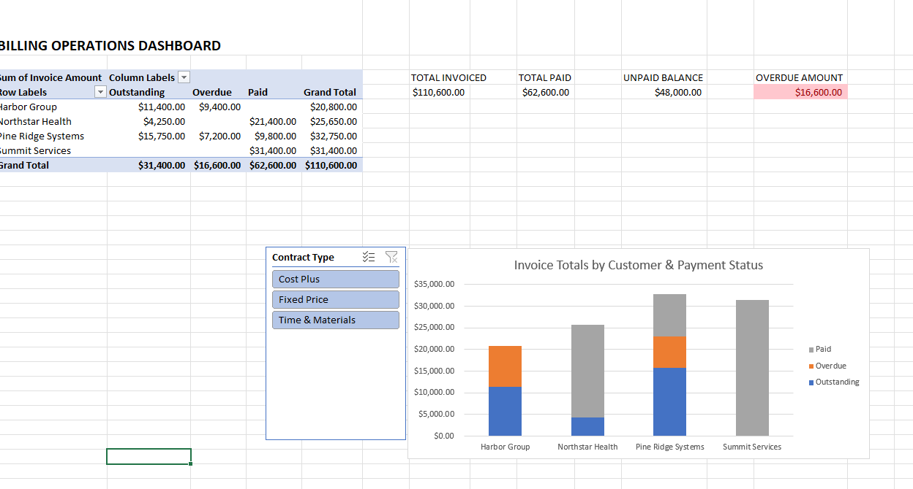
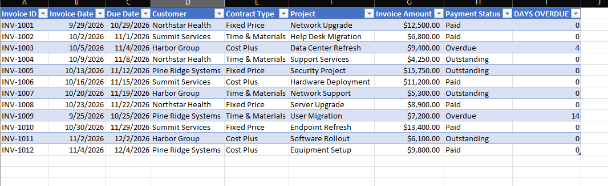
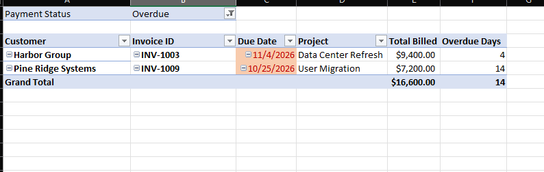

# Billing Operations Dashboard

An Excel practice project demonstrating invoice tracking, billing summaries, and overdue-account reporting.

## Dashboard Overview

The summary dashboard includes customer payment-status totals, KPI figures, a contract-type slicer, and a stacked column chart.

## Invoice Register

The source register tracks invoice IDs, invoice and due dates, customers, contract types, projects, invoice amounts, payment status, and days overdue.

## Overdue Invoice Detail

The overdue report filters to overdue invoices and summarizes the customer, invoice ID, due date, project, total billed, and overdue days.

## Project Workbook

[Download the Excel practice workbook](Billing_Operations_Practice.xlsx)
