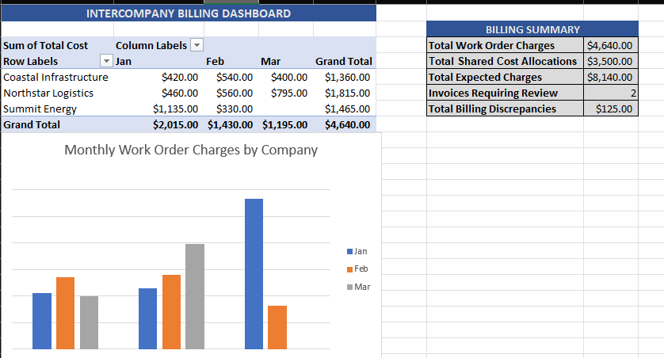
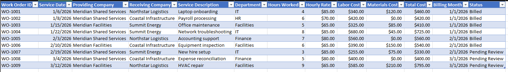
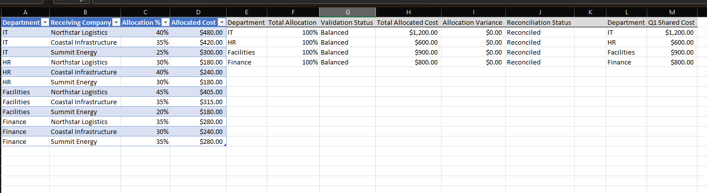
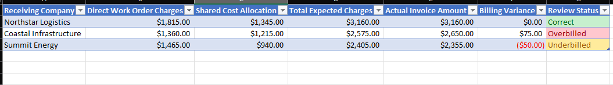

# Intercompany Billing Tracker

A **simulated Excel portfolio project** demonstrating intercompany work-order tracking, shared-service cost allocation, invoice reconciliation, and management reporting. All company names, work orders, invoices, and figures are fictional.

## Project Overview

This workbook models two distinct billing streams:
1. **Direct work-order charges** for services delivered to a specific receiving company.
2. **Shared departmental expenses** allocated across receiving companies using percentage-based allocation rules.

These streams are combined into expected intercompany charges, then compared with simulated invoice amounts to identify billing variances. Pending-review work orders are included in expected charges for practice purposes; they would require approval before posting in a real billing workflow.

## Dashboard

A PivotTable and PivotChart summarize monthly direct work-order charges by receiving company. KPI metrics show expected billing totals and discrepancies.

## Work Orders

Tracks providing and receiving entities, service dates, labor hours, hourly rates, materials, total costs, billing months, and status.

## Allocation Rules

Distributes a separate Q1 shared-cost pool across three receiving companies by department, with **100% allocation validation** and **dollar reconciliation** controls.

## Invoice Review

Combines direct and shared charges into expected totals and uses formulas plus conditional formatting to flag **Correct**, **Overbilled**, and **Underbilled** invoices.

## Excel Workbook

[Download the Intercompany Billing Tracker workbook](Intercompany_Billing_Tracker_Practice.xlsx)

## Sample Results

| Metric | Amount |
| --- | ---: |
| Direct work-order charges | $4,640.00 |
| Shared departmental allocations | $3,500.00 |
| Total expected intercompany charges | $8,140.00 |
| Invoices requiring review | 2 |
| Total absolute billing discrepancies | $125.00 |

## Excel Skills Demonstrated

- Excel Tables and structured references
- `SUMIF`, `SUMIFS`, `XLOOKUP`, `IF`, `SUMPRODUCT`, and date formulas
- Percentage-based cost allocations and balance checks
- Invoice variance detection and conditional formatting
- PivotTables, PivotCharts, and reporting summaries

*Practice project only; no real customer, employer, or financial records are included.*
